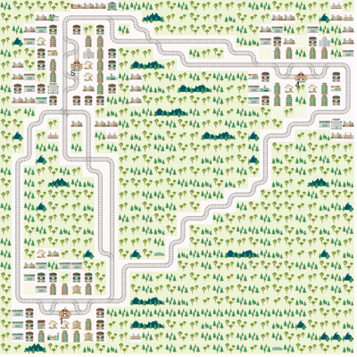
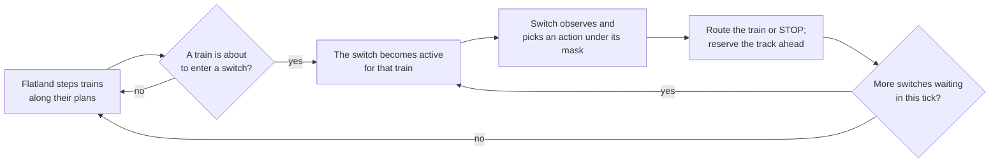

<div align="center">

# SwitchFL

**A switch-centred multi-agent reinforcement learning environment on top of [Flatland](https://flatland.aicrowd.com/)**

[](https://www.python.org/)
[](https://github.com/flatland-association/flatland-rl)
[](https://pettingzoo.farama.org/api/aec/)
[](https://docs.astral.sh/uv/)
[](LICENSE)

[Quickstart](#quickstart) · [How it works](#how-it-works) · [API](#api) · [Baselines](#baselines) · [Development](#development) · [Citation](#citation)

</div>

---

In Flatland, the agents are the **trains**. In SwitchFL, the agents are the **railway switches**. Trains drive on their own, and whenever a train is about to enter a switch, that switch decides where the train goes, or holds it in front of the switch. This turns train routing into a decentralised control problem that is close to how real interlocking and signalling work: many small decision points that have to coordinate without a central planner.

<div align="center">
  
  <br>
  <sub>Six trains, 26 switch agents, shortest-path routing (seed 0): all trains delivered in 93 steps.<br>
  Regenerate with <code>uv run python examples/demo.py --show 0 --gif images/demo.gif --gif-width 400 --gif-fps 10</code></sub>
</div>

## Highlights

- **Switches as agents.** Every switch in the rail network is an agent with its own observation, action space and action mask.
- **Asynchronous by design.** Agents act only when a train arrives, one *(switch, train)* decision at a time, through the [PettingZoo AEC](https://pettingzoo.farama.org/api/aec/) loop.
- **Semi-MDP interface.** [`SwitchCore`](#semi-mdp-interface-switchcore) returns proper transitions with the elapsed time `τ`, the next decision point and local and team rewards, as needed for TD learning such as Q-routing.
- **Safe routing.** Action masks and track reservations keep trains from entering an occupied switch, from being routed where their target is unreachable, and from meeting head-on on single-track lines. Deadlocks are still possible and are for the policy to avoid.
- **Deterministic.** The same seed gives the same episode; the rail layout stays fixed across resets.
- **Baselines and demo included.** Random and shortest-path routing, plus a runnable demo with GIF export.

## Quickstart

### Install

SwitchFL needs Python 3.12 and is managed with [uv](https://docs.astral.sh/uv/):

```bash
git clone https://github.com/RobinU434/SwitchFL.git
cd SwitchFL
uv sync --all-extras
```

> [!NOTE]
> SwitchFL is pinned to stock `flatland-rl==4.2.2`. If you used the old `flatland_patch/` files in a uv venv, they also overwrote uv's cached copy of Flatland. Repair it once with `uv cache clean flatland-rl && uv sync --reinstall-package flatland-rl`.

### Run the demo

```bash
uv run python examples/demo.py                                 # shortest-path routing, seed 0
uv run python examples/demo.py --policy compare --episodes 10  # random vs. shortest path
uv run python examples/demo.py --gif demo.gif --gif-width 400  # save the episode as an animation
uv run python examples/demo.py --help                          # all options with their defaults
```

The demo prints every switch decision it shows and a summary of the episode:

```text
  t=  45  switch_25-9    train 3  ports blocked [0, 0, 1]  allowed [3, 4]  -> route (25.1, 9.1) -> (25.3, 9.3)
  ...
shortest_path routing, seed 0:
  trains delivered      6/6
  total delay           -139 steps (negative = early)
  Flatland steps        93
  switch decisions      53 by 22 different switches
  ...
```

### Minimal example

```python
import numpy as np
from switchfl.utils.build_env import build_standard_async_env

env = build_standard_async_env(height=30, width=30, max_num_cities=3, num_trains=6, seed=0)
env.reset(seed=0)
rng = np.random.default_rng(0)

for agent in env.agent_iter():            # the next switch with a train in front of it
    obs = env.observe(agent)              # what this switch sees
    mask = env.infos[agent]["action_mask"]
    action = rng.choice(np.flatnonzero(mask))   # replace with your policy
    env.step(action)                      # Flatland advances once every waiting switch has decided
```

## How it works



1. The Flatland grid is turned into a graph of switches. Each switch has **ports**, one per side it connects to.
2. Trains follow their queued actions until one of them reaches a switch. That *(switch, train)* pair becomes the next agent in `agent_iter()`. Several pairs that arise in the same Flatland step are handled one after another.
3. The switch either routes the train from its in-port to one of its out-ports or holds it with **STOP**. A routing decision **reserves** the track ahead: the next segment, and the whole line if it is single-track through crossings, so no oncoming train can enter it.
4. Once every waiting switch has decided, Flatland advances again.

### Switch types


| Flatland cell | Agent class | Rail actions | Action space |
|---|---|---|---|
| simple switch left/right, symmetrical switch (cases 2, 2b, 6) | `Switch1` | 4 | `Discrete(5)` |
| diamond crossing (case 3) | `Switch2` | 4 | `Discrete(5)` |
| single slip switch (case 4) | `Switch3` | 6 | `Discrete(7)` |
| double slip switch (case 5) | `Switch4` | 8 | `Discrete(9)` |

Each rail action moves a train from one port to another; the last action is always STOP. Maps from Flatland's `sparse_rail_generator` mostly contain simple switches and double slips. See [`switchfl/switch_agents.py`](switchfl/switch_agents.py).

## API

### Observation

The default `StandardObserver` gives each switch a fixed-size integer vector that always lies in `env.observation_space(agent)`:

| Part | Size | Meaning |
|---|---|---|
| node id | 2 | position of the switch in the grid |
| port flags | ports | 1 if the track behind that port is free for the active train, 0 if an oncoming train or a broken-down train ahead has reserved it |
| targets | 2 × ports | target cell of the active train at its in-port, `-1` elsewhere |
| delay | ports | discretised delay of the active train at its in-port, `-1` elsewhere |

A switch that is not currently deciding sees a "no train" observation (targets and delays `-1`). `info` also contains a compact `reduced_obs` for tabular methods. To use your own observation, subclass `_Observer` in [`switchfl/observer.py`](switchfl/observer.py) and pass it as `ASyncSwitchEnv(rail_env, observer=MyObserver())`; its `observe()` must also return `info["action_mask"]`.

### Action mask

`env.infos[agent]["action_mask"]` is filled by `env.observe(agent)`, so observe first. It allows a rail action only if

- it starts at the port where the train is waiting,
- the track behind the exit is not reserved by an oncoming train or a broken-down train ahead, along the whole single-track line,
- the train's target is still reachable from that exit,
- no other train enters or occupies the switch in the same step, and the train is not broken down.

STOP is always allowed.

### Reward

The env's reward is the change of the train's delay since its previous switch, minus a penalty (1300) for STOP while an exit was free. It is credited to the switch the train reaches next and stored per train in `env._cumulative_rewards[next_switch][train]`; PettingZoo's `env.rewards` / `env.last()` do not carry it. `env.step()` returns an info dict with `next_switch` and `arrived_trains`, which deviates from PettingZoo but gives TD methods their next state. For learning, prefer the transitions of `SwitchCore` below.

### Semi-MDP interface (`SwitchCore`)

For learners that need clean transitions, [`switchfl.core.SwitchCore`](switchfl/core.py) wraps the env:

```python
from switchfl.core import SwitchCore

core = SwitchCore(env)
decision = core.reset(seed=0)                 # Decision(switch, train, obs, mask, t, info)
while decision is not None:
    action = my_policy(decision.obs, decision.mask)
    decision, transitions = core.act(action)
    for tr in transitions:                    # closed when the train reaches its next decision point
        learn(tr.switch, tr.obs, tr.action, tr.reward, tr.tau, tr.next_switch, tr.next_obs, tr.terminal)
```

Each `Transition` carries the elapsed Flatland steps `tau` (for `γ^τ`), the next switch and its observation and mask, whether the train arrived (`terminal`) or the episode ended (`truncated`), and two rewards **credited to the switch that acted**: the train's own delay change, minus `stop_penalty` (default 1300) if the switch chose STOP although a rail action was allowed (`reward`), and the change of all trains' delay (`team_reward`). A Q-routing design built on this interface is described in [`docs/q_routing.md`](docs/q_routing.md).

Choose the reward with `SwitchCore(env, reward=...)`:

| `reward=` | `reward` (acting switch) | `team_reward` |
|---|---|---|
| `"delay"` (default) | change of the train's delay until its next decision, minus `stop_penalty` for an unforced STOP | change of all trains' delay |
| `"arrival"` | `1` if the train reached its target before its next decision, else `0` | number of trains that arrived in that time |

`"arrival"` is the vanilla sparse objective: only getting trains to their destination counts.

### Framework compatibility

| Framework | Fit |
|---|---|
| PettingZoo AEC | native (`ASyncSwitchEnv`) |
| RLlib `MultiAgentEnv` | good fit for an adapter on top of `SwitchCore` (not included yet) |
| TorchRL / BenchMARL, Tianshou | through their PettingZoo AEC wrappers |
| EPyMARL, MARLlib, JaxMARL | poor fit: they expect every agent to act every step |

### Rendering

```python
env = build_standard_async_env(..., render_mode="rgb_array")   # or "human" for a matplotlib window
frame = env.render()                                          # numpy image of the Flatland map
```

## Baselines

[`switchfl/baselines.py`](switchfl/baselines.py) provides two policies with the signature `policy(env, switch, train, mask) -> action`:

| Policy | Trains delivered (one 30×30 map with 3 cities, 6 trains, 10 episode seeds) |
|---|---|
| `random_policy(rng)`: uniformly random allowed action | 10 / 60 |
| `shortest_path_policy`: exit closest to the train's target | 51 / 60 |

Reproduce with `uv run python examples/demo.py --policy compare --episodes 10 --show 0`. Undelivered trains under shortest-path routing are mostly deadlocks at switches that a policy has to learn to avoid.

## Development

```bash
uv run pytest test/                    # 142 tests
uv run pytest test/test_semaphores.py -v
```

| Path | Content |
|---|---|
| `switchfl/switch_env.py` | `ASyncSwitchEnv`, the asynchronous AEC loop |
| `switchfl/rail_network.py` | switch graph, ports, track reservations |
| `switchfl/switch_agents.py` | the four switch types |
| `switchfl/observer.py` | observations, action masks, blocking rules |
| `switchfl/core.py` | `SwitchCore` semi-MDP interface |
| `switchfl/baselines.py` | random and shortest-path policies |
| `switchfl/utils/flatland_compat.py` | all Flatland rail calls, with notes for newer versions |
| `examples/demo.py` | runnable demo |
| `docs/q_routing.md` | Q-routing learner design |
| `test/` | stability, learning-readiness, reservation and transition tests |

Contributions are welcome: fork the repository, create a branch, and open a pull request.

## Roadmap

- Q-routing learner on top of `SwitchCore` ([design](docs/q_routing.md))
- RLlib `MultiAgentEnv` adapter
- Several environments in parallel processes on the same map
- Port to Flatland 4.3+

## Citation

If you use SwitchFL in your research, please cite:

```bibtex
@misc{uhrich2025switchfl,
  title  = {SwitchFL: Switch-Centered Flatland Environment for Multi-Agent Reinforcement Learning},
  author = {Uhrich, Robin and Mussi, Marco and Restelli, Marcello},
  year   = {2025},
  url    = {https://github.com/RobinU434/SwitchFL}
}
```

## License

Released under the [MIT License](LICENSE).

## Related projects

- [Flatland](https://flatland.aicrowd.com/): the railway simulation SwitchFL builds on
- [PettingZoo](https://pettingzoo.farama.org/): the multi-agent API SwitchFL implements
